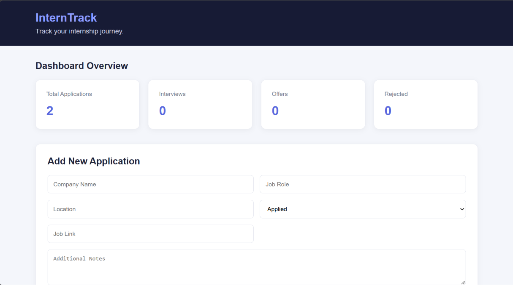

# InternTrack – Internship Application Tracker

A full-stack web application designed to help students organize and manage their internship applications in one place.

## 🌐 Live Demo

- **Frontend:** https://swynex-complete-deployed-applicatio.vercel.app
- **Backend API:** https://interntrack-backend-cyx8.onrender.com
- **GitHub Repository:** https://github.com/pranavchauhan0102-ui/SWYNEX-Complete-Deployed-Application

## 🚀 Features

- Add new internship applications.
- View all saved applications.
- Update existing application details.
- Delete applications.
- Search applications by company name.
- Filter applications by application status.
- Dashboard statistics for applications, interviews, offers and rejections.
- Persistent data storage using MongoDB Atlas.
- Responsive frontend interface.

## 🛠️ Tech Stack

**Frontend**
- HTML5
- CSS3
- JavaScript

**Backend**
- Node.js
- Express.js
- Mongoose

**Database**
- MongoDB Atlas

**Deployment**
- Vercel – Frontend
- Render – Backend

## 📁 Project Structure

```text
SWYNEX-Complete-Deployed-Application/
│
├── frontend/
│   ├── index.html
│   ├── style.css
│   ├── script.js
│   └── screenshots/
│       └── dashboard.png
│
├── backend/
│   ├── config/
│   ├── controllers/
│   ├── models/
│   ├── routes/
│   ├── server.js
│   ├── package.json
│   └── .env.example
│
├── .gitignore
└── README.md
```

## ⚙️ Local Setup

### 1. Clone the repository

```bash
git clone https://github.com/pranavchauhan0102-ui/SWYNEX-Complete-Deployed-Application.git
```

### 2. Set up the backend

```bash
cd SWYNEX-Complete-Deployed-Application/backend
npm install
```

Create a `.env` file inside the backend folder:

```env
PORT=5000
MONGO_URI=your_mongodb_connection_string
```

### 3. Start the backend

```bash
npm start
```

The backend will run locally at:

`http://localhost:5000`

### 4. Run the frontend

Open `frontend/index.html` using VS Code Live Server.

For local development, update the API URL in `frontend/script.js` to:

```javascript
const API_URL = "http://localhost:5000/api/applications";
```

For the deployed version, use the Render backend URL configured in the project.

## 🔗 API Endpoints

| Method | Endpoint | Description |
|---|---|---|
| POST | `/api/applications` | Create application |
| GET | `/api/applications` | Get all applications |
| GET | `/api/applications/:id` | Get application by ID |
| PUT | `/api/applications/:id` | Update application |
| DELETE | `/api/applications/:id` | Delete application |

## 📸 Screenshots

### Application Dashboard



## 🎯 Project Objective

The objective of InternTrack is to provide students with a simple and organized platform to track internship opportunities, monitor application progress and manage their job-search journey efficiently.

## 🔮 Future Improvements

- User authentication and personalized dashboards.
- Application deadlines and reminder notifications.
- Advanced analytics and reporting.
- Resume and document management.

---

**Developed as part of the SWYNEX Technologies Internship Project.**